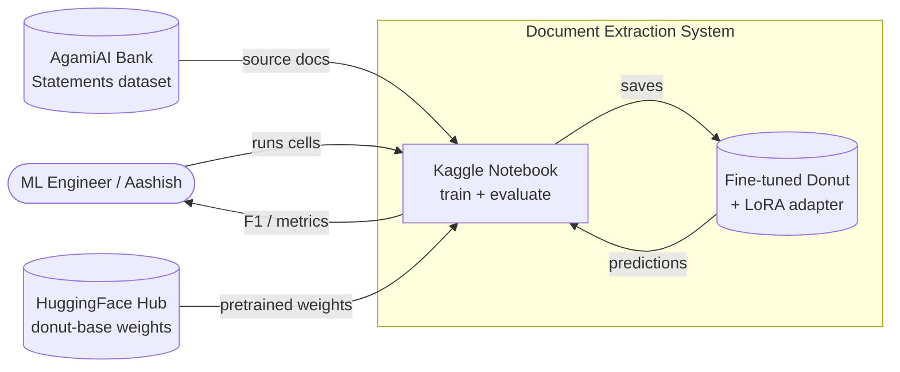
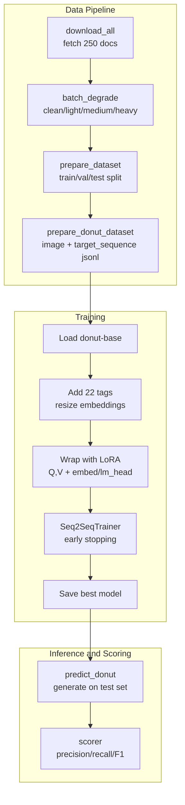
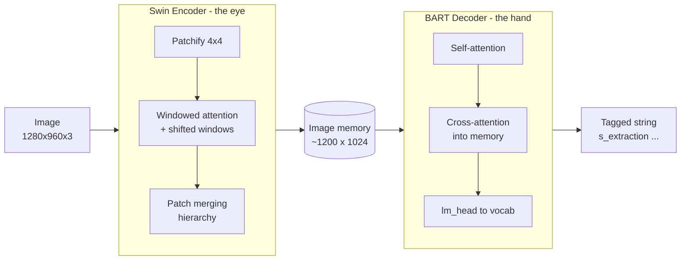

# Architecture — Fine-Tuned Donut for Scanned Document Extraction

**Project:** Vision-Language model (Donut + LoRA) that extracts 10 header fields from
degraded scanned Indian bank statements.
**Status:** Training complete; inference-loader fix under validation.

---
         
## 1. System context (C4 — Level 1)

**One-line:** pixels in → structured tagged string out, no OCR step.

---

## 2. Container / component view

---

## 3. Model architecture (the two halves)

- **Encoder (Swin):** turns 3.6M pixels into ~1,200 semantic vectors.
- **Decoder (BART):** autoregressively writes tokens, cross-attending into the image memory.
- **Custom tags:** 22 new vocabulary tokens (`<s_account_number>` … `</s_extraction>`).

---

## 4. Key design decisions

| Decision | Choice | Rationale |
|---|---|---|
| Base model | `donut-base` (~200M) | OCR-free, fits free T4, strong doc pretraining |
| Fine-tuning | LoRA on Q/V | Cheap, high-impact steering; avoids overfitting small data |
| New tokens | full-train `embed_tokens`+`lm_head` | Random-init tags can't be learned by low-rank adapters |
| Memory | grad checkpointing + fp16 + batch1/accum8 | Fits 15 GB T4 |
| Image size | 1280×960 | Preserves tiny digits on dense statements |
| Stopping | early stop, best on `eval_loss` | Avoids overfitting past epoch 5 |

---

## 5. Known risk / the inference bug

The training process sets `pad_token_id` / `decoder_start_token_id`, but the **separate
inference process** reloads base Donut and does **not** inherit them — causing empty
generation (0.000 F1). Fix: re-apply this config in `load_finetuned_model()` and mirror it
onto `generation_config`. See `LLD.md` §4.
