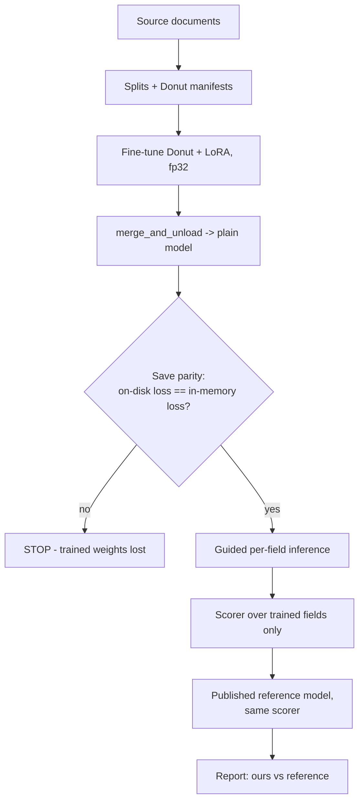
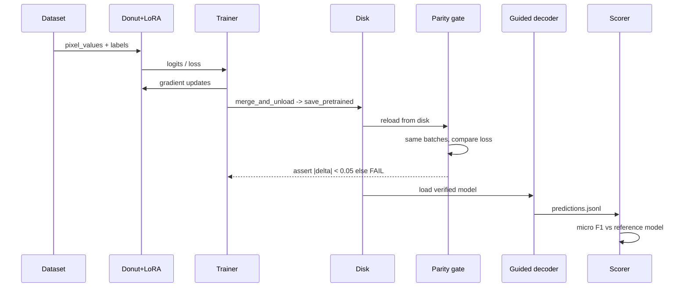

# High-Level Design (HLD)

**Component:** Fine-Tuned Donut Document Extraction
**Audience:** reviewers, interviewers, future maintainers
**Last updated:** 2026-09-27

---

## 1. Purpose & scope

Test whether a small vision-language model (Donut ~200M), fine-tuned on domain-specific
scans, can match or beat OCR+rules and zero-shot large VLMs for structured field
extraction — at a fraction of the cost.

**Two use cases were run through the same pipeline:**

| Use case | Inputs | Fields | **F1** |
|---|---|---|---|
| Bank statements | 580 synthetic, 4 degradation tiers | 10 header fields | 0.026 |
| **Receipts (CORD-v2)** | 800 real photos | 6 numeric summary fields | **0.901** |
| — reference full fine-tune | same test set, same scorer | same 6 | 0.976 |

**In scope:** flat scalar fields, single page.
**Out of scope:** transaction-line tables, multi-page stitching, PHI/real customer data.

---

## 2. High-level flow

The `P` gate is the single most important box in this diagram — see §7.

---

## 3. Major components

| Component | Responsibility | Tech |
|---|---|---|
| Data pipeline | fetch, split, format to tagged targets | datasets, PIL |
| Model core | encode image, decode tags | Donut (Swin + mBART) |
| Fine-tuning | LoRA adapters + full-train new token rows | PEFT, Transformers |
| Trainer | loss, eval, checkpoint | Seq2SeqTrainer, fp32 |
| **Checkpoint gate** | **prove the saved model == the trained model** | **loss comparison** |
| Inference | guided per-field constrained decoding | Transformers `generate` |
| Evaluation | micro + per-field P/R/F1, vs published reference | custom scorer |
| Serving | HTTP field extraction | FastAPI (`serve.py`) |

---

## 4. Data flow (train → verify → serve)

---

## 5. Quality attributes

- **Cost:** free T4; receipt run was ~7 GPU-hours end to end.
- **Correctness:** no result is reported unless the checkpoint passes the parity gate.
- **Comparability:** every number is produced by the same scorer that scores a published
  reference model, so "0.901" is anchored rather than self-reported.
- **Reproducibility:** fixed splits, single self-contained notebook, no repo clone.

---

## 6. Acceptance criteria

| Metric | Target | Receipt result |
|---|---|---|
| Save parity `max abs delta` | < 0.05 | 0.0000 |
| Micro F1 | within 0.10 of published reference | 0.901 vs 0.976 (gap 0.075) |
| Structural validity of output | 100% parseable | 100% (guided decoding) |
| Non-empty predictions | 100% | 100% |

---

## 7. Design decisions that mattered

| Decision | Why | Evidence |
|---|---|---|
| **fp32, not fp16** | fp16 on T4 diverged | loss 47 → 0.000 F1; fp32 fell 2.088 → 0.007 |
| **Verify checkpoints by loss** | shape/key checks pass on untrained weights | a `matched: 484` guard passed while on-disk loss was 9–11 vs 0.000 |
| **`merge_and_unload()`, never hand-rolled** | manual key rewriting silently drops weights | fixing it moved F1 0.070 → 0.901 with no retraining |
| **Guided per-field decoding** | free-running generation loops and reorders tags | zero malformed outputs across 100 receipts |
| **Score against a published model** | absolute F1 is meaningless alone | reference 0.976 proved the pipeline, not the data, was fine |
| **No quality gate in production** | it was validated on synthetic blur only | lift @p90 = **−0.026** on real photos; ungated wins |

See `LLD.md` for module-level detail.

