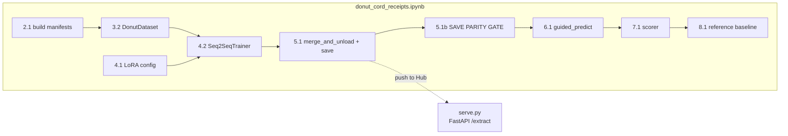
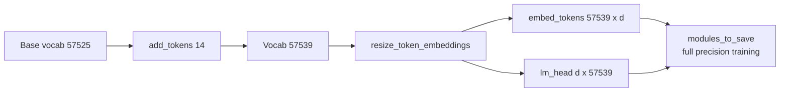
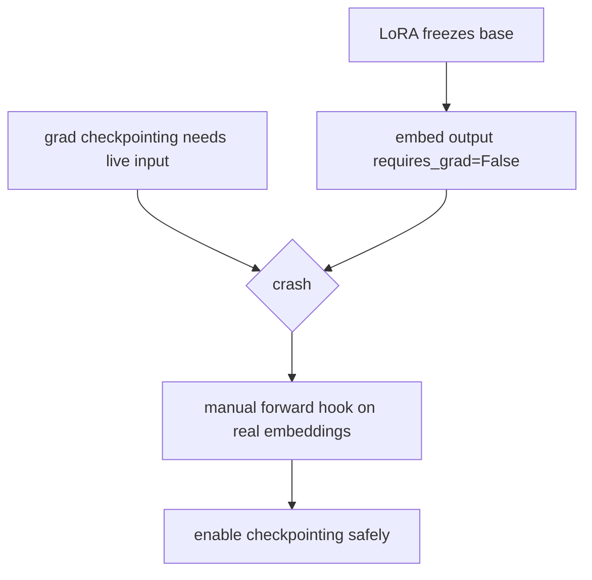
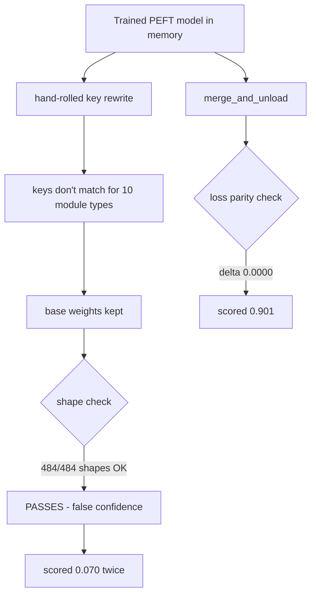
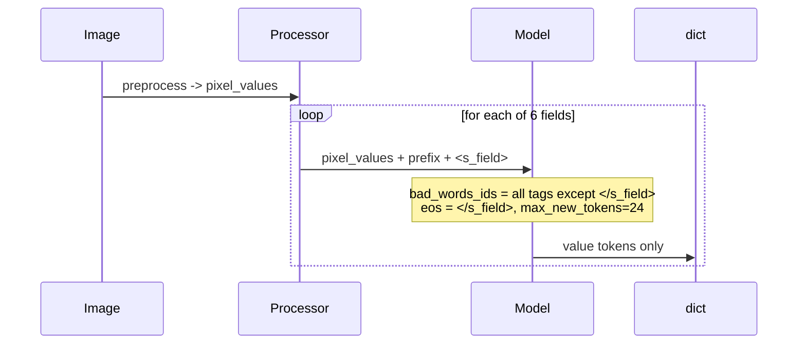

# Low-Level Design (LLD)

**Component:** Fine-Tuned Donut Document Extraction
**Audience:** implementers / debuggers
**Last updated:** 2026-09-27

> Values below are the **receipt** configuration (`notebooks/donut_cord_receipts.ipynb`,
> F1 0.901). Where the earlier bank-statement run differed and was wrong, both are shown.

---

## 1. Module map



---

## 2. Custom vocabulary

- Wrapper: `<s_extraction>`, `</s_extraction>`
- Per field × 6: `<s_field>`, `</s_field>`
- Total: **14 tokens** (bank-statement run used 22 for 10 fields), appended to the
  tokenizer; embeddings resized; new rows random-init then trained.

New rows are random at init, so `embed_tokens` and `lm_head` **must** be in
`modules_to_save` — LoRA alone would leave them random and the model would emit garbage
tags.



---

## 3. Training configuration

| Param | Receipt value | Bank-statement value | Note |
|---|---|---|---|
| epochs | 20 | 10 | eval_loss bottomed at **epoch 6**; see §8 |
| batch / accum | 1 / 4 | 1 / 8 | effective batch 4 → ~4000 steps |
| lr / schedule | 5e-4 cosine | 1e-4 | |
| warmup | `warmup_steps=120` | — | this build rejects `warmup_ratio` |
| **precision** | **fp32** | fp16 | **fp16 on T4 → loss 47, F1 0.000** |
| grad checkpointing | on | on | + manual require-grad hook |
| LoRA r / alpha | **64 / 128** | 16 / 32 | 16/32 on Q,V only underfits |
| target_modules | query, key, value, dense, q_proj, k_proj, v_proj, out_proj, fc1, fc2 | Q, V | encoder + decoder attn **and** MLP |
| lora_dropout | 0.05 | 0 | |
| modules_to_save | embed_tokens, lm_head | same | full-train new tag rows |
| image size | 1280 × 960 | — | set on processor **and** `config.encoder.image_size` |
| MAX_LENGTH | 128 | 768 | 6 short scalar fields only |
| save_total_limit | 1 | — | see §8 — this discarded the best checkpoint |

### Gradient-checkpointing hook (why)

LoRA freezes the base model, so the embedding output has `requires_grad=False`, and
gradient checkpointing has nothing to re-attach to on the backward pass.



```python
def _req_grad(module, inp, out):
    (out[0] if isinstance(out, tuple) else out).requires_grad_(True)
model.get_input_embeddings().register_forward_hook(_req_grad)
model.gradient_checkpointing_enable()
```

---

## 4. The save bug & fix (CRITICAL)

**Symptom:** F1 0.070 across two full training runs, while training loss reached 0.007.

**Root cause:** the checkpoint was written by a hand-rolled state-dict fold that rewrote
PEFT key names by string surgery (`removeprefix('base_model.model.')`, `.base_layer`,
`.modules_to_save.default`). Once LoRA covered ten module types plus two
`ModulesToSaveWrapper`s, most keys no longer matched — so the **base** weight was kept
for nearly every tensor. **The saved model was, in effect, untrained.**

**Why the existing guard missed it:** it asserted `matched > 0.9 * len(ref_sd)`, counting
**shape** matches. Untrained base weights have identical shapes, so the check passed at
`matched: 484`.



**Fix — delete the manual fold:**

```python
merged = model.merge_and_unload()   # handles lora.Linear AND ModulesToSaveWrapper
leftover = [n for n, _ in merged.named_modules()
            if 'lora' in n.lower() or 'modules_to_save' in n or 'original_module' in n]
assert not leftover
merged.config.tie_word_embeddings = False            # lm_head != embed_tokens now
merged.decoder.config.tie_word_embeddings = False
merged.save_pretrained(SAVE_PATH, safe_serialization=True)
```

**Fix — the gate that would have caught it (cell 5.1b):**

```python
disk = VisionEncoderDecoderModel.from_pretrained(SAVE_PATH).to(device).eval()
rows = [(merged(pixel_values=pv, labels=lb).loss.item(),
         disk(pixel_values=pv, labels=lb).loss.item()) for pv, lb in batches]
gap = max(abs(d - t) for t, d in rows)
assert gap < 0.05, f'SAVE BUG: max |delta| = {gap:.4f}'
```

Observed before the fix: `trained 0.0000 / on_disk 9.1680 / max |delta| 11.5135`.
After: `max |delta| = 0.0000`.

> **Rule: a checkpoint is unverified until you have compared its loss to the in-memory
> model on identical batches.** Key counts and shapes prove nothing.

### Secondary (still valid): generation config is not inherited

A fresh process reloads the base model and never re-applies `pad_token_id` /
`decoder_start_token_id`, so `generate()` has no valid start token and returns empty
output. Re-apply both after every load — `serve.py` reads them from the saved config.

---

## 5. Inference — guided per-field decoding

Free-running `generate()` loops `<s_extraction>` and emits doubled, out-of-order tags
even with `repetition_penalty` and beams. Instead the **tag skeleton is supplied** and
only the value is generated, one field at a time, with every other structural tag banned
and `</s_field>` as EOS. Output is structurally correct by construction.



Cost: **six sequential `generate` calls per image** (~0.5 s GPU, ~4 s CPU). Batch the six
prefixes if throughput matters.

---

## 6. Scoring

- Compared **digits-only**: `re.sub('[^0-9]', '', v)`, so `60,000` == `60.000` == `60000`.
- Empty gold → skipped (not counted either way).
- Wrong non-empty prediction → **FP and FN** (it is both a miss and a false claim).
- Only **trained** fields are scored; the repo's original scorer counted ~20 gold fields
  against 10 trained tags, capping any model at ~0.5 by construction.
- The **same function** scores a published reference model — that comparison is what
  makes the number trustworthy.

---

## 7. Data structures

`train.jsonl` line:
```json
{"doc_id": "train_0000", "image_path": "/kaggle/working/cord/train/0000.png",
 "gold": {"total_price": "60000", "cashprice": "70000", "...": ""},
 "target_sequence": "<s_extraction><s_total_price>60000</s_total_price>...</s_extraction>"}
```

Every target contains **all** fields, empty when absent, so the training targets match
the guided-decoding skeleton exactly.

`POST /extract` response:
```json
{"filename": "receipt.jpg",
 "fields": {"total_price": "60000", "cashprice": "70000", "changeprice": "10000",
            "subtotal_price": "54545", "tax_price": "5455", "discount_price": ""}}
```

---

## 8. Validation gates

| Gate | Cell | Rule |
|---|---|---|
| No PEFT modules survive merge | 5.1 | `assert not leftover` |
| Vocab == tokenizer length | 5.1 | `assert rows == tl` |
| **Save parity** | **5.1b** | **`assert max abs delta < 0.05`** |
| Structural validity | 6.1 | guided decoding makes this unconditional |
| Reference comparison | 8.1 | reference high + ours low ⇒ our bug, not the data |

**Retired gate:** `n_nonempty > 0`. It passed on a completely untrained checkpoint.

**Retired gate:** Laplacian legibility threshold. Validated on synthetically blurred
scans, where it tracked the injected corruption; on real receipt photos its lift @p90 is
**−0.026**, i.e. tightening the threshold *lowered* F1 while cutting coverage to 10%.
The correct abstain signal is decoder sequence log-probability.

---

## 9. Known issues

- **Overfitting after epoch 6.** `eval_loss` 0.1706 @ e6 → 0.2036 @ e20. With
  `save_total_limit=1` and `load_best_model_at_end=False`, only epoch 20 survived. Fix:
  `EPOCHS=8`, `load_best_model_at_end=True`, `metric_for_best_model='eval_loss'`,
  `save_total_limit=2`.
- **No confidence output.** ~10% of returned values are wrong with nothing marking them.
- **`discount_price` F1 0.667** on 6 test samples — statistically meaningless.

